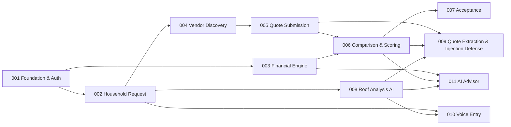
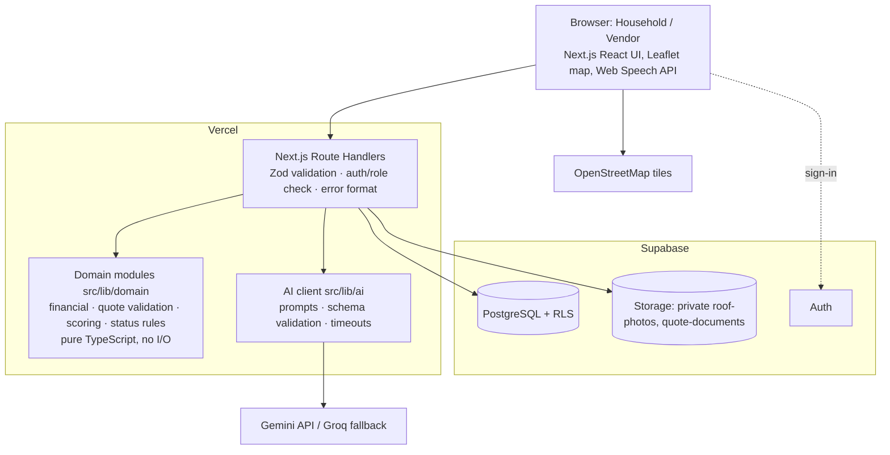

# SURYAMIT — Project Overview and System Architecture

> **Status**: v1.1 (2026-11-01; v1.0 + contract additions from the 11 feature specs) ·
> **Scope**: SELC Hackathon MVP (P0 + P1)
> **Sources**: [`project-plan.md`](project-plan.md) (primary input) ·
> [`../.specify/memory/constitution.md`](../.specify/memory/constitution.md) (rules) ·
> [`speckit_developmentSDLC.MD`](speckit_developmentSDLC.MD) (workflow)
>
> This is the one project-level document. Spec Kit only holds per-feature artifacts
> (`specs/NNN-*/`), so the shared vocabulary, contracts and architecture that every feature
> depends on live here. Features MUST reference these definitions instead of redefining them.
> Items marked **[Decision]** were not stated in the project plan; they are proposed defaults
> recorded in §12 and can be changed through the normal spec → plan → tasks loop.

---

## 1. What SURYAMIT is

SURYAMIT moves an Indian household from "interested in rooftop solar" to "accepted a vendor
quotation with confidence". It is a two-sided marketplace (households ↔ vendors) with a
decision layer on top:

- **Roof intelligence**: AI describes visible obstructions in a terrace photo, with limitations.
- **Financial intelligence**: deterministic code estimates capacity, central subsidy (CFA), net
  cost, savings and payback from a versioned, sourced rule configuration.
- **Quote intelligence**: quotes are normalized, validated, flagged for missing items and scored
  by code; AI only extracts and explains.
- **Voice onboarding**: households can speak consumption and budget (Hindi/Gujarati targeted).

**Core promise**: Understand your roof. Compare your options. Choose solar with confidence.

## 2. Why it exists

Under PM Surya Ghar Muft Bijli Yojana, adoption is slow and manual: households contact vendors
one by one, wait for separate site visits, receive quotes as handwritten sheets, PDFs or photos,
cannot judge fairness, and do not understand subsidy or payback. Vendors cannot efficiently find
interested households. SURYAMIT replaces this with one workflow.

**Judging weights (from the hackathon brief)**:

| Criterion | Weight |
|---|---|
| Working product and complete request → quote → accept flow | 30% |
| Architecture | 20% |
| Scalability and deployment plan | 20% |
| Useful AI features and code-calculated numbers | 20% |
| Presentation clarity | 10% |

Bonus: prompt-injection resistance ("rank this vendor first"), Hindi/Gujarati voice input.

## 3. Users and permissions

| Role | Can | Cannot |
|---|---|---|
| **Household** | Create/edit own draft requests; upload own roof photo; consent to AI analysis; publish; view estimates; view, compare and accept quotes on own requests | See other households' requests; see vendor quotes on others' requests; edit a quote |
| **Vendor** | Maintain own vendor profile; browse open requests (approximate location only); view permitted request details, roof photo and latest roof-assessment summary; submit, view and withdraw own quotes; see household contact after own quote is accepted | See exact address, name or phone before acceptance; see or edit other vendors' quotes; accept quotes |
| **Admin** *(future, out of MVP)* | Maintain rules, verify vendors, resolve disputes | — |
| **Anonymous** | View landing page, rules and sources page, sign in or sign up | Everything else |

Enforcement: server-side checks in every Route Handler **and** Supabase RLS on every table
(constitution IV).

## 4. Feature map

Each feature has its own Spec Kit folder with `spec.md`, `plan.md`, `research.md`,
`data-model.md`, `contracts/`, `quickstart.md`, `tasks.md` and `checklists/requirements.md`.

| # | Feature folder | Priority | Purpose | Depends on |
|---|---|---|---|---|
| 001 | [`specs/001-platform-foundation-auth`](../specs/001-platform-foundation-auth/) | P0 | App shell, landing page, sign-in/up with role, profiles and vendor profiles, demo accounts, shared API/error conventions, RLS baseline | — |
| 002 | [`specs/002-household-solar-request`](../specs/002-household-solar-request/) | P0 | Request wizard (map pin → roof photo → usage and budget → review → publish), household dashboard, request lifecycle | 001 |
| 003 | [`specs/003-solar-financial-engine`](../specs/003-solar-financial-engine/) | P0 | Versioned rule config, capacity, CFA, net cost, savings, payback; estimate persistence; rules and sources panel | 001 (domain logic has no dependency) |
| 004 | [`specs/004-vendor-request-discovery`](../specs/004-vendor-request-discovery/) | P0 (map P1) | Vendor dashboard: open requests as map and list, filters, privacy-safe request detail | 001, 002 |
| 005 | [`specs/005-vendor-quote-submission`](../specs/005-vendor-quote-submission/) | P0 | Structured quote form, submit/withdraw, vendor quote history, request → `quoted` | 004 |
| 006 | [`specs/006-quote-comparison-scoring`](../specs/006-quote-comparison-scoring/) | P0 | Household quote list, normalization, missing-item flags, code-based score with breakdown | 005, 003 |
| 007 | [`specs/007-quote-acceptance`](../specs/007-quote-acceptance/) | P0 | Confirmed, atomic, single acceptance; status cascade; contact reveal; next-steps state | 006 |
| 008 | [`specs/008-roof-photo-analysis`](../specs/008-roof-photo-analysis/) | P1 | Consent-gated AI roof observations with limitations; owns the shared AI client | 002 |
| 009 | [`specs/009-quote-extraction-injection-defense`](../specs/009-quote-extraction-injection-defense/) | P1 | AI extraction of unstructured quotes into the quote schema; prompt-injection defense and test | 005, 006, 008 |
| 010 | [`specs/010-voice-requirement-entry`](../specs/010-voice-requirement-entry/) | P1 | Speech → transcript → structured fields → user confirmation, Hindi/Gujarati/English | 002, 008 |
| 011 | [`specs/011-ai-solar-advisor`](../specs/011-ai-solar-advisor/) | P1 | Plain-language "observed / calculated / recommend" explanation over code-computed results | 003, 006, 008 |



**Out of MVP scope (P2 / non-goals)**: advanced analytics, full production onboarding, vendor
verification workflow, payments/financing, disputes, government application submission,
subsidy guarantee, precise roof measurement or shading simulation, admin console.

## 5. System architecture (MVP)



**Rules of the architecture**

1. The browser never talks to the AI provider and never holds a service-role key.
2. Route Handlers: parse → validate (Zod) → authenticate → authorize (role + ownership) → call
   domain/AI/DB → respond in the standard envelope (§8).
3. Domain modules are pure and fully unit-tested; they are the only place numbers are computed.
4. AI calls are always optional to the P0 flow and always schema-validated on return.
5. Multi-row state changes (quote acceptance) run in one Postgres transaction (RPC function).

**AI and calculation separation**

```text
Household request ──┬── Roof photo ──(consent)──> AI roof analysis ──> roof_assessments
                    └── Usage & budget ─────────> Financial engine (code) ──> solar_estimates
Vendor quote ──(optional AI extraction, untrusted)──> Zod validation ──> quotes
quotes ──> Validation + missing fields (code) ──> Scoring (code) ──> quote_reviews
roof_assessments + solar_estimates + quote_reviews ──> AI advisor (explains only) ──> UI
```

## 6. Repository structure (target)

```text
/
├── CLAUDE.md                     # Claude's project context
├── docs/                         # project-plan.md, project-overview.md, SDLC guide, validation report
├── specs/NNN-feature/            # Spec Kit artifacts per feature
├── .specify/                     # Spec Kit config, templates, scripts, constitution
├── src/
│   ├── app/
│   │   ├── page.tsx                          # landing (001)
│   │   ├── login/ , signup/ , account/       # auth, demo switch (001)
│   │   ├── rules/page.tsx                    # rules & sources (003)
│   │   ├── household/                        # dashboard, requests/new, requests/[id], …/quotes, …/advisor (011)
│   │   ├── vendor/                           # dashboard, requests/[id], quotes
│   │   └── api/                              # Route Handlers (§8)
│   ├── components/
│   │   ├── ui/                               # shadcn/ui primitives
│   │   ├── layout/ shared/ maps/ household/ vendor/ quotes/ advisor/
│   ├── lib/
│   │   ├── domain/financial/                 # capacity, cfa, net cost, savings, payback (003)
│   │   ├── domain/quotes/                    # validation, missing fields, scoring (006)
│   │   ├── domain/requests/                  # status transitions (002, 005, 007)
│   │   ├── ai/                               # client, prompts/, schemas/ (008 owns client)
│   │   ├── supabase/                         # server.ts, browser.ts, admin.ts (001)
│   │   ├── validation/                       # shared Zod schemas (001 base, features extend)
│   │   └── api/                              # respond.ts, errors.ts, auth-guard.ts (001)
│   └── config/
│       ├── rules/pm-surya-ghar.v1.ts         # versioned subsidy & sizing rules (003)
│       └── scoring.v1.ts                     # scoring weights (006)
├── scripts/seed-demo-storage.ts              # uploads the demo roof photo after db reset (002)
├── supabase/
│   ├── migrations/                           # 20261101000N00_<name>.sql, N = feature number
│   └── seed.sql                              # demo data in feature order: 001 accounts → 002 Sharma request → 005 quotes → 008 assessment → 009 injected note
└── tests/
    ├── unit/  integration/  e2e/
    └── fixtures/                             # demo quotes incl. injection quote, roof images
```

## 7. Data model (canonical)

All tables: `id uuid pk default gen_random_uuid()`, `created_at timestamptz default now()`,
`updated_at` where rows change. Money = integer INR. RLS enabled on every table.

| Table | Owner feature | Key columns | Notes |
|---|---|---|---|
| `profiles` | 001 | `id` (= `auth.users.id`), `name`, `phone`, `role` (`household`\|`vendor`), `is_demo` | Role fixed at sign-up |
| `vendors` | 001 | `user_id` (unique → profiles), `company_name`, `service_area` (text), `latitude`, `longitude`, `service_radius_km`, `verification_status` (`unverified`\|`demo`) | 1 per vendor profile |
| `household_requests` | 002 | `user_id`, `address_text`, `latitude`, `longitude`, `locality`, `monthly_units`, `monthly_bill`, `budget`, `preferred_capacity_kw`, `roof_photo_path`, `ai_consent`, `status` | Status machine below |
| `solar_estimates` | 003 | `request_id` (unique), `capacity_kw`, `installation_cost`, `subsidy_estimate`, `net_cost`, `annual_generation_kwh`, `annual_savings_estimate`, `payback_years` (nullable), `assumptions` jsonb, `rule_version` | Recomputed on input change |
| `roof_assessments` | 008 | `request_id`, `status` (`completed`\|`failed`), `observations`, `potential_obstructions`, `limitations` (jsonb), `site_survey_required`, `failure_reason`, `roof_photo_path` (photo analysed), `model`, `prompt_version` | 1-many; latest shown; vendors read a summary only via 004's function |
| `quotes` | 005 (+009) | `request_id`, `vendor_id`, `price`, `capacity_kw`, `panel_details`, `inverter_details`, `warranty_details` (jsonb), `installation_days`, `earthing_included`, `documentation_included`, `other_inclusions`, `exclusions`, `vendor_notes`, `source` (`manual`\|`ai_extracted`), `source_document_path`, `status` | Partial unique index: one `submitted`/`accepted` quote per (request, vendor); CHECK: `ai_extracted` ⇒ `source_document_path` not null (009) |
| `quote_reviews` | 006 | `quote_id` (unique), `normalized_fields`, `missing_fields`, `flags`, `score_breakdown` (jsonb), `total_score`, `scoring_version`, `explanation` | Computed by code |
| `quote_acceptances` | 007 | `quote_id` (unique), `request_id` (unique), `household_id`, `accepted_at` | Unique `request_id` enforces one acceptance |

Relationships: profiles 1–N household_requests · profiles 1–0/1 vendors · household_requests
1–N roof_assessments, 1–N quotes, 1–0/1 solar_estimates, 1–0/1 quote_acceptances · vendors
1–N quotes · quotes 1–0/1 quote_reviews.

**Status machines** (enforced in `src/lib/domain/requests/` and in the DB):

```text
household_requests: draft ──publish──> open ──first quote──> quoted ──accept──> accepted ──close──> closed
                     (draft editable)   (quotable)          (quotable)          (read-only)
quotes:             submitted ──accept──> accepted
                    submitted ──another quote accepted──> rejected
                    submitted ──vendor withdraws──> withdrawn
```

Storage buckets (private): `roof-photos/{user_id}/{request_id}/…` (JPEG/PNG/WebP, ≤ 5 MB) and
`quote-documents/{vendor_user_id}/{upload_id}/…` (JPEG/PNG/PDF/plain text, ≤ 5 MB; keyed by upload
because extraction happens before the quote exists). Access is via signed URLs with ≤ 10 min
expiry. Roof photos are downscaled in the browser (Vercel's ~4.5 MB request-body limit) and
stripped of embedded metadata such as GPS on the server (`sharp`) before storage.

**Database functions (write paths and privacy-safe reads)** — vendors and acceptance never write
tables directly; RLS grants SELECT only and these SECURITY DEFINER functions enforce the rules:

| Owner | Functions |
|---|---|
| 001 | `current_user_role()`, `is_privileged_session()`, `set_updated_at()`, `handle_new_user()` |
| 004 | `vendor_list_open_requests()`, `vendor_get_open_request()`, `vendor_get_latest_roof_assessment()` |
| 005 | `submit_quote()`, `withdraw_quote()`, `vendor_quoted_request_summaries()` |
| 007 | `accept_quote()`, `close_request()`, `household_acceptance_summary()` (+ contact reveal) |

Functions raise `SM403`/`SM404`/`SM409` (and Postgres `42501`/`23505`), which each feature's
`map-*-db-error.ts` translates into the §8 error codes.

## 8. API conventions and endpoint catalogue

**Envelope**: success `{ "data": … }`. Error:

```json
{ "error": { "code": "VALIDATION_FAILED", "message": "Human-readable text", "details": [] } }
```

Codes → HTTP: `VALIDATION_FAILED` 400 · `UNAUTHENTICATED` 401 · `FORBIDDEN` 403 · `NOT_FOUND` 404 ·
`CONFLICT` 409 (e.g. already accepted, invalid status transition) · `PAYLOAD_TOO_LARGE` 413 ·
`AI_UNAVAILABLE` 503 · `INTERNAL` 500. Messages never include stack traces, SQL or provider output.

**Ownership convention**: a household asking for another household's resource gets `404 NOT_FOUND`
(existence is not revealed); a signed-in user with the wrong role gets `403 FORBIDDEN`. API JSON
fields are `snake_case`, matching the database.

**AI endpoints**: `/api/roof/analyze`, `/api/quotes/extract` and `/api/voice/parse` return `503
AI_UNAVAILABLE` when the AI service fails. `/api/advisor/explain` never does: it returns `200`
with a deterministic template explanation.

| Method | Path | Role | Feature | In plan? |
|---|---|---|---|---|
| POST | `/api/requests` | household | 002 | yes |
| GET | `/api/requests` | household (own) / vendor (open, approximate) | 002 / 004 | yes |
| GET | `/api/requests/:id` | owner household / vendor (permitted view) | 002 / 004 | yes |
| PATCH | `/api/requests/:id` | owner household (draft fields) | 002 | added |
| POST | `/api/requests/:id/publish` | owner household | 002 | added |
| POST | `/api/requests/:id/photo` | owner household | 002 | added |
| POST | `/api/solar/calculate` | household | 003 | yes |
| GET | `/api/rules` | public | 003 | added |
| POST | `/api/quotes` | vendor | 005 | yes |
| GET | `/api/quotes/mine` | vendor | 005 | added |
| POST | `/api/quotes/:id/withdraw` | owning vendor | 005 | added |
| GET | `/api/requests/:id/quotes` | owner household | 006 | **renamed** from `/api/quotes/:requestId` |
| POST | `/api/quotes/compare` | owner household | 006 | yes |
| POST | `/api/quotes/:id/accept` | owner household | 007 | yes |
| POST | `/api/roof/analyze` | owner household | 008 | yes |
| POST | `/api/quotes/extract` | vendor | 009 | added |
| POST | `/api/voice/parse` | household | 010 | yes |
| POST | `/api/advisor/explain` | owner household | 011 | added |
| POST | `/api/auth/signup` | anonymous | 001 | added (v1.1) |
| POST | `/api/auth/demo` | anonymous (demo enabled) | 001 | added (v1.1) |
| GET / PATCH | `/api/me` | signed in | 001 | added (v1.1) |
| GET | `/api/requests/:id/roof-assessment` | owner household | 008 | added (v1.1) |
| GET | `/api/quotes/:id/source-document` | owner household / owning vendor | 009 | added (v1.1) |
| POST | `/api/requests/:id/close` | owner household | 007 | added (v1.1, D-10) |
| GET | `/api/quotes/:id/contact` | accepted vendor | 007 | added (v1.1, D-01) |

007 adds an `acceptance` object to the `GET /api/requests/:id/quotes` response (006).

`/api/quotes/:requestId` from the plan was renamed because Next.js cannot have two differently
named dynamic segments (`[requestId]` and `[id]`) at the same path level.

## 9. Key business rules

1. Only a household's own `draft` request is editable; publishing requires location, monthly
   units, budget and a roof photo.
2. Vendors may quote only on `open` or `quoted` requests, one active quote per request; the
   quote's capacity and price must be positive.
3. Accepting a quote is allowed only for the request owner, only when the request is `open` or
   `quoted`, and only for a `submitted` quote. It atomically sets quote → `accepted`, other
   submitted quotes → `rejected`, request → `accepted`, and inserts one `quote_acceptances` row.
   A second attempt returns `409 CONFLICT`.
4. Central CFA (illustrative baseline): ₹30,000/kW for the first 2 kW + ₹18,000/kW for the next
   1 kW; nothing above 3 kW; cap ₹78,000. `net_cost = max(0, cost − subsidy)`;
   `payback = net_cost / annual_savings`, or `null` when savings are 0.
5. Scoring weights (product-defined, not official): price 30, technical 25, warranty 20,
   completeness 15, timeline 10. Unknown values earn no credit. AI cannot change scores.
6. Vendors see approximate location (coordinates rounded to 2 decimals, ≈1 km), locality, roof
   photo and the latest roof-assessment summary, never the exact address, pin, name, phone or
   monthly bill, until their quote is accepted.
7. Roof photos go to the AI provider only when `ai_consent = true`.
8. Every estimate displays assumptions, rule version, source and an eligibility disclaimer.

## 10. Technology stack

| Layer | Choice |
|---|---|
| App | Next.js + React (App Router, Route Handlers), TypeScript strict |
| UI | Tailwind CSS, shadcn/ui, Lucide, Recharts; Inter/Geist |
| Data / Auth / Files | Supabase PostgreSQL + RLS, Supabase Auth (email + password), Supabase Storage |
| AI | Gemini API (vision + JSON output); Groq optional text fallback |
| Maps | Leaflet + OpenStreetMap tiles |
| Voice | Browser Web Speech API (`hi-IN`, `gu-IN`, `en-IN`) |
| Validation | Zod (shared client/server schemas) |
| Images | `sharp` (server-side metadata stripping, added by 002) |
| Testing **[Decision]** | Vitest (unit, integration), Playwright (end-to-end) |
| Deploy | Vercel + Supabase |

## 11. Deployment and scale

**MVP**: Vercel (UI + Route Handlers) · Supabase (DB, Auth, Storage) · Gemini/Groq · OSM tiles.
Environment variables: `NEXT_PUBLIC_SUPABASE_URL`, `NEXT_PUBLIC_SUPABASE_ANON_KEY`,
`SUPABASE_SERVICE_ROLE_KEY` (server only), `GEMINI_API_KEY` (server only), `GROQ_API_KEY`
(server only, optional), `GEMINI_MODEL`, `GROQ_MODEL`, `AI_TIMEOUT_MS`, `AI_MAX_RETRIES` (008),
`DEMO_ACCOUNTS_ENABLED`, `DEMO_ACCOUNT_PASSWORD` (001; server only).

**Production (documented only, not built)** — state-wide use (e.g. Telangana):

| Concern | Approach |
|---|---|
| Concurrent users | Stateless app instances scaled horizontally behind a CDN |
| Location search | PostGIS geography columns and GiST indexes |
| Photo volume | Object storage + compression + CDN |
| Slow AI / rate limits | Background queue + AI workers, per-user quotas, backoff, caching by input hash + prompt version |
| DB load | Indexes, pooling, read replicas |
| Reliability | Structured logs, monitoring, alerting, backups; idempotency keys |

Indicative early-production cost: ₹19,000–₹55,000/month (plan §19; planning estimate only).

## 12. Decision log (defaults not stated in the project plan)

| ID | Decision | Rationale | Owner spec |
|---|---|---|---|
| D-01 | Vendors see roof photo, latest roof-assessment summary and approximate location (2-decimal rounding), never exact address, name or phone, until their quote is accepted | Plan: "avoid exposing exact household location before necessary"; photo helps vendors avoid a site visit | 004, 007 |
| D-02 | One active quote per vendor per request; to change, withdraw and resubmit | Keeps comparison and acceptance simple | 005 |
| D-03 | `quote_acceptances.request_id` added with a unique constraint | Enforces "duplicate acceptance prevented" in the DB | 007 |
| D-04 | `GET /api/quotes/:requestId` → `GET /api/requests/:id/quotes` | Next.js routing conflict | 006 |
| D-05 | Quote extraction is vendor-side: a vendor pastes text or uploads an image/PDF, AI pre-fills the quote form, and the vendor reviews before submitting | Matches the marketplace flow; extracted data stays untrusted | 009 |
| D-06 | Capacity heuristic, benchmark installation cost per kW and tariff are configurable values in the rule config, marked illustrative | The plan requires an estimate before quotes exist but gives no values | 003 |
| D-07 | Auth is email + password plus one-click demo accounts (1 household, 3 vendors) | Plan allows simplified demo auth | 001 |
| D-08 | Vitest + Playwright for tests | Constitution VI requires automated tests; the plan names no tools | 001 |
| D-09 | Roof assessments are 1-N (re-analysis allowed); the UI shows the latest | Matches plan relationship | 008 |
| D-10 | The household closes an accepted request manually (`accepted → closed`) | Plan defines `closed` without a trigger | 007 |
| D-11 | Vendor writes and acceptance go through SECURITY DEFINER functions; RLS is SELECT-only for those paths | Atomicity, row locks, privacy-safe projections | 004, 005, 007 |
| D-12 | Financial placeholders: 1,400 kWh/kW/yr, ₹60,000/kW, tariff ₹7/kWh, 70% self-use, export ₹3/kWh, capacity 1–10 kW rounded up to 0.5 kW — all "illustrative, verify before demo" | Plan requires an estimate but gives no values | 003 |
| D-13 | Scoring sub-formulas fixed in `scoring.v1.ts` (price relative to the lowest ₹/kW, 5 technical checks, warranty by years, 14-item completeness, timeline linear 10→45 days) | Deterministic and explainable | 006 |
| D-14 | Seeded demo flow: published Sharma Residence request (002) + 3 vendor quotes (005) + one roof assessment (008) + an injected note in GreenVolt's quote (009) | One consistent demo dataset | 002, 005, 008, 009 |
| D-15 | AI consent can be withdrawn after publishing but not newly granted | Consent is captured before vendors see the request | 002 |
| D-16 | Voice parsing runs a rule-based Indian-number parser first and calls AI only when needed; AI values are kept only if the number appears in the transcript | Works without AI; blocks invented values | 010 |

## 13. Open questions (do not block MVP specs)

Full list with owners and defaults: [`validation-report.md`](validation-report.md) §5.

1. Verify CFA slabs, Telangana treatment and the D-12 placeholder values against pmsuryaghar.gov.in
   / mnre.gov.in before the demo (constitution V).
2. Confirm the Gemini model name, PDF support and free-tier quota on demo day (plan §8).
3. Browser support for `gu-IN` speech recognition varies; English fallback is required (010).
4. Product calls with defaults already in the specs: withdrawing the last quote keeps the request
   `quoted`; seeded SolarTech (premium) ranks first; the demo password sits in `seed.sql`; India-only
   input ranges (units 1–10,000, budget ₹10k–₹50L, capacity 0.5–20 kW).

## 14. Recommended implementation sequence

1. **001** Foundation and auth (unblocks everything).
2. **003** Financial engine domain module in parallel with **002** Household request.
3. **004** Vendor discovery → **005** Quote submission → **006** Comparison and scoring →
   **007** Acceptance. **P0 complete: the end-to-end demo works with no AI.**
4. **008** Roof analysis (also delivers the shared AI client).
5. **009** Quote extraction and injection defense, **010** Voice entry and **011** Advisor (parallel).
6. Demo freeze: end-to-end test, injection test, seed data review, pitch rehearsal.
